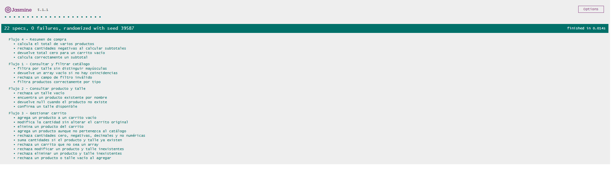
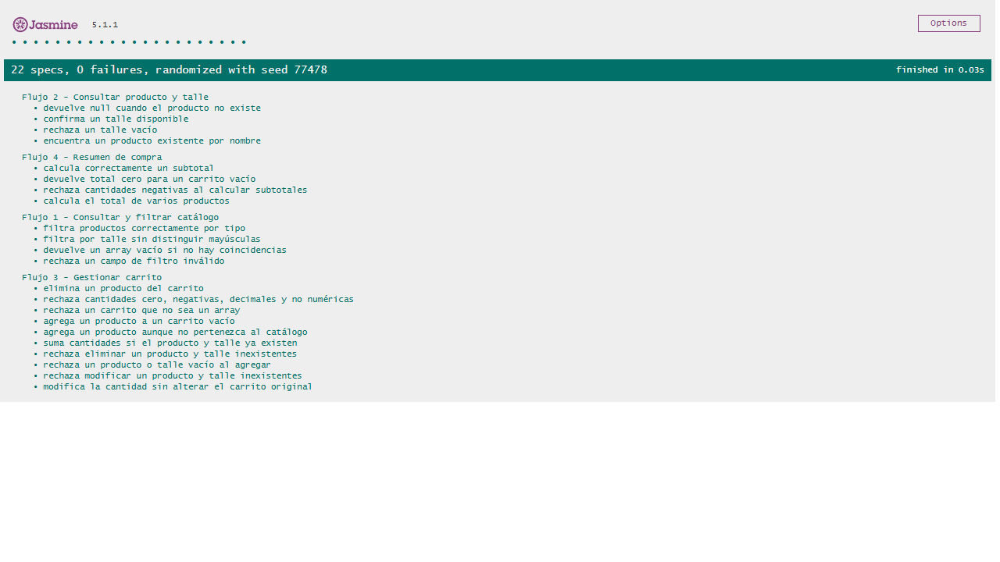

# Spec — Tester JavaScript / QA Engineer

**Autor:** Juan Martin Britos  
**Matrícula:** 155984  
**Materia:** Programación Web I  
**Entrega:** Actividad Obligatoria N.º 3  
**Proyecto:** Remer Us — Tienda Online  
**Rol:** Tester JavaScript / QA Engineer  
**Rama:** `feature/tester-javascript-jasmine`
**Issue asociada:** [#88](https://github.com/dantebiondi666-prog/tienda-online/issues/88)
---

## 1. Objetivo

Planificar e implementar pruebas automatizadas sobre la lógica de negocio JavaScript de Remer Us, utilizando Jasmine como framework de testing y Playwright MCP para ejecutar las pruebas en un navegador real.

Se buscará verificar que los cuatro flujos principales funcionen correctamente, contemplando operaciones normales, valores límite y entradas inválidas.

## 2. Plan de testing (BEFORE)

La estrategia consiste en desarrollar cuatro suites de pruebas, una por cada flujo principal implementado en `js/script.js`.

Los nombres definitivos de los flujos y las funciones a probar se confirmarán cuando estén disponibles los diagramas de actividades y el código JavaScript del desarrollador.

| Suite | Funcionalidad | Funciones a probar | Pruebas planificadas |
|---|---|---|---|
| Suite 1 | Consultar y filtrar catálogo | `filtrarProductos()`, `obtenerOpcionesFiltro()` | Filtrado correcto, resultados vacíos y criterios inválidos |
| Suite 2 | Consultar producto y talle | `buscarProducto()`, `verificarTalleDisponible()` | Producto existente, talle disponible/no disponible y entradas inválidas |
| Suite 3 | Gestionar carrito | `agregarAlCarrito()`, `modificarCantidad()`, `eliminarDelCarrito()` | Agregar, modificar, eliminar, cantidades inválidas y conservación del carrito original |
| Suite 4 | Resumen de compra | `calcularSubtotal()`, `calcularTotal()`, `generarResumenCompra()` | Cálculos correctos, carrito vacío y precios/cantidades inválidos |

Cada suite tendrá un mínimo de tres tests. Se incorporarán también pruebas de operaciones con arrays y objetos, según las funciones disponibles.

### 2.1 Tipos de pruebas

- **Happy path:** comprobar que las funciones devuelvan los resultados esperados con entradas válidas.
- **Casos borde:** verificar el comportamiento ante valores cero, negativos, valores grandes y cadenas vacías, cuando corresponda.
- **Validación de errores:** comprobar el tratamiento de datos inválidos, tipos incorrectos, `null` y `undefined`.
- **Arrays y objetos:** verificar operaciones de búsqueda, filtrado, modificación y procesamiento de colecciones, según la implementación.
- **Cálculos:** comprobar resultados numéricos y reglas de negocio aplicables.

### 2.2 Dependencias

Para comenzar la implementación de las pruebas será necesario contar con:

- Los cuatro diagramas de actividades del proyecto.
- El archivo `js/script.js` con las funciones implementadas.
- Funciones de negocio que reciban parámetros y devuelvan resultados.
- Separación entre la lógica de negocio y la interacción mediante `prompt()` y `alert()`.

## 3. Herramientas

### Jasmine

Se utilizará Jasmine mediante CDN para crear y ejecutar pruebas unitarias en el navegador.

Permitirá organizar los tests mediante `describe()` e `it()` y verificar resultados mediante assertions como `expect().toBe()` y `expect().toEqual()`.

### GitHub Copilot Agent Mode

Se utilizará como asistencia para generar las suites de pruebas a partir del archivo `js/script.js`.

Los tests generados serán revisados y ajustados para asegurar que representen correctamente el comportamiento esperado de las funciones.

### Playwright MCP

Se utilizará para abrir `js/test/test-runner.html` en un navegador real, ejecutar las suites de Jasmine y capturar evidencias de los resultados PASS/FAIL.

Estas herramientas permiten automatizar las verificaciones y documentar los resultados de forma reproducible.

## 4. Archivos previstos

| Archivo | Responsabilidad |
|---|---|
| `js/test/test-runner.html` | Cargar Jasmine, el código JavaScript y los tests |
| `js/test/script.spec.js` | Contener las cuatro suites de pruebas |
| `js/test/testing-doc.md` | Documentar ejecución, cobertura, resultados y evidencias |
| `docs/03-specs/actividad-obligatoria-3/spec-tester.md` | Registrar planificación, decisiones y cierre del trabajo |

## 5. Criterios de aceptación

- [x] La especificación fue commiteada antes de crear `script.spec.js`.
- [x] Se implementaron cuatro suites Jasmine, una por flujo principal.
- [x] Cada suite contiene al menos tres tests.
- [x] Se cubren casos normales, casos borde y validaciones de errores.
- [x] Se verifican operaciones con arrays y objetos.
- [x] `test-runner.html` carga correctamente Jasmine y los archivos necesarios.
- [x] Se ejecutaron las cuatro suites mediante Playwright MCP.
- [x] Se capturaron screenshots de los resultados PASS.
- [x] Se documentaron las pruebas y sus resultados en `js/test/testing-doc.md`.
- [x] Se ejecutaron 22 tests Jasmine, con 22 PASS y 0 FAIL.
- [x] No fue necesario modificar `js/script.js`.
- [x] Se actualizó `changelog.md` con la contribución y el enlace a la PR #91.
- [x] Se abrió la Pull Request #91 hacia `develop` para revisión.

## 6. Evidencia de cierre (AT CLOSE)

### 6.1 Herramientas y asistencia utilizada

Se utilizó ChatGPT como asistencia para elaborar las cuatro suites de pruebas unitarias, tomando como referencia los flujos funcionales previstos para la Actividad Obligatoria N.º 3.

Posteriormente, se utilizó GitHub Copilot Agent Mode con Playwright MCP para ejecutar Jasmine en un navegador y verificar los resultados.

**Prompt utilizado en Copilot Agent Mode:**

> Utilizá Playwright MCP para abrir http://localhost:3000/js/test/test-runner.html y ejecutar las pruebas de Jasmine de la Actividad Obligatoria N.º 3.
>
> Verificá que se ejecuten las cuatro suites y registrá la cantidad total de tests, tests aprobados y fallidos.
>
> Tomá una captura de pantalla del resultado y guardala en js/test/capturas/jasmine-playwright-pass.png.
>
> Si hay errores, informá cuáles son y sus mensajes exactos.
>
> No modifiques js/script.js, script.spec.js ni otros archivos del proyecto. No hagas commits ni pushes. Solamente ejecutá las pruebas, guardá la captura y devolvé un resumen de los resultados.

#### 6.1.1 Ampliación de tests mediante Copilot Agent

Se utilizó GitHub Copilot en modo Agent desde Visual Studio Code, tomando `js/script.js` como contexto principal y revisando `js/test/script.spec.js`.

**Prompt utilizado:**

> Analizá js/script.js como contexto principal y revisá js/test/script.spec.js. Necesito generar y mejorar las cuatro suites Jasmine correspondientes a los flujos de la Actividad Obligatoria N.º 3.
>
> En particular, corregí la Suite 3 (Gestionar carrito) incorporando pruebas de casos borde y entradas inválidas, incluyendo cantidades inválidas y operaciones sobre productos inexistentes, según el comportamiento real de las funciones.
>
> Requisitos:
> 1. Conservá los tests existentes que sean correctos.
> 2. Agregá tests que verifiquen resultados reales, sin inventar comportamientos.
> 3. Utilizá describe(), it() y expect() de Jasmine.
> 4. No modifiques js/script.js.
> 5. Modificá únicamente js/test/script.spec.js.
> 6. Informá qué tests agregaste o modificaste y por qué.
> 7. Indicá cualquier limitación de testabilidad detectada.
>
> Antes de modificar el archivo, analizá las funciones y explicá brevemente los casos que vas a incorporar.

**Resultado generado:** Copilot Agent agregó 53 líneas a `js/test/script.spec.js`, incorporando seis tests adicionales a la Suite 3. Se conservaron las pruebas existentes y no se modificó `js/script.js`.

**Ajustes manuales posteriores:** No se realizaron modificaciones manuales adicionales a los tests después de la intervención de Copilot Agent.

**Validación:** `node --check` y `git diff --check` finalizaron correctamente. La ejecución posterior de Jasmine en Chrome obtuvo 22 tests aprobados y 0 fallidos. **Validación automatizada posterior:** Se ejecutaron nuevamente las cuatro suites mediante GitHub Copilot Agent y Playwright MCP, obteniendo 22 tests aprobados y 0 fallidos.

**Evidencia:** `js/test/capturas/jasmine-playwright-22-tests-pass.png`.

Durante la ejecución se registró un error HTTP 404 para `favicon.ico`, sin impacto en las pruebas Jasmine.

### 6.2 Resultados de las pruebas

| Métrica | Resultado final |
|---|---|
| Suites ejecutadas | 4 |
| Tests ejecutados | 22 |
| Tests PASS | 22 |
| Tests FAIL | 0 |
| Resultado general | PASS |
| Framework | Jasmine 5.1.1 |
| Validación automatizada | Playwright MCP |

**Flujos evaluados:**

1. Consultar y filtrar catálogo.
2. Consultar producto y talle.
3. Gestionar carrito.
4. Resumen de compra.

Se ejecutaron correctamente los 22 casos de prueba, sin fallos funcionales detectados en las verificaciones realizadas.

No se registraron Issues de bugs funcionales derivados de estos tests.

#### Retest posterior a las correcciones RC1 y RC2 — PR #91

La ejecución inicial contemplaba 16 tests Jasmine, todos aprobados.

Durante la revisión de la PR #91, se utilizó GitHub Copilot Agent con `js/script.js` como contexto para ampliar la Suite 3 (Gestionar carrito), incorporando seis pruebas adicionales para cubrir casos borde, entradas inválidas y operaciones sobre elementos inexistentes.

Posteriormente, se repitió la ejecución en Google Chrome y mediante Playwright MCP.

**Resultado final del retest:**

- Suites ejecutadas: 4.
- Tests ejecutados: 22.
- Tests aprobados: 22.
- Tests fallidos: 0.
- Resultado: PASS.
- Errores de ejecución Jasmine: ninguno.

**Evidencias:**

- Ejecución manual: `js/test/capturas/jasmine-22-tests-pass.png`.
- Ejecución mediante Playwright MCP: `js/test/capturas/jasmine-playwright-22-tests-pass.png`.

La ejecución inicial de 16 tests se conserva únicamente como antecedente histórico. El resultado final vigente es **22 tests PASS y 0 FAIL**, verificados mediante Playwright MCP.

### 6.3 Evidencias de Playwright MCP

Las cuatro suites se ejecutaron correctamente mediante Jasmine 5.1.1
en Google Chrome y mediante Playwright MCP.

**Resultado final: 22 tests PASS, 0 FAIL.**

**Ejecución manual — 22 tests PASS:**

**Ejecución automatizada mediante Playwright MCP — 22 tests PASS:**

Las capturas correspondientes a la ejecución inicial de 16 tests
se conservan como evidencia histórica, pero no representan
el resultado final vigente.

La documentación detallada de las pruebas se encuentra en
`js/test/testing-doc.md`.

### 6.4 Ajustes manuales y coordinación

Se crearon los siguientes archivos:

- `js/test/test-runner.html`
- `js/test/script.spec.js`
- `js/test/testing-doc.md`

Inicialmente se implementaron cuatro suites con cuatro tests cada una, obteniendo 16 pruebas aprobadas.

Posteriormente, durante las correcciones de la Pull Request #91, se utilizó GitHub Copilot Agent con `js/script.js` como contexto para ampliar la Suite 3 (Gestionar carrito), incorporando seis pruebas adicionales.

**Resultado actualizado:** 4 suites, 22 tests aprobados y 0 fallidos.

Las pruebas verifican operaciones de filtrado, búsqueda, validación de talles, manipulación de arrays y objetos, gestión del carrito, entradas inválidas y cálculos.

No fue necesario modificar `js/script.js` para obtener los resultados PASS.

#### Coordinación con el Desarrollador JavaScript — RC3

Se realizó una consulta a Seba, integrante del equipo de desarrollo JavaScript, para aclarar el comportamiento de la aplicación ante productos inexistentes y entradas incorrectas.

Seba explicó que el tratamiento de estas situaciones fue previsto intencionalmente para evitar que los errores de ingreso interrumpan la ejecución del programa y permitir que el usuario continúe utilizando el menú.

También aclaró que la implementación del código se realizó con asistencia de GitHub Copilot.

Esta coordinación permitió conocer la intención del diseño. Sin embargo, se mantiene la distinción entre el comportamiento esperado y el comportamiento observado en las funciones, que debe verificarse mediante las pruebas automatizadas.

Las pruebas Jasmine se ejecutaron correctamente sin modificar el código de negocio.

**Resultado de la coordinación:** se completó la consulta con el
Desarrollador JavaScript, quien aclaró que el tratamiento de entradas
incorrectas y productos inexistentes fue una decisión intencional para
evitar interrupciones en la ejecución del programa.

Desde el rol de Tester se verificó que las funciones de negocio
pudieran ejecutarse mediante Jasmine sin modificar `js/script.js`,
obteniendo 22 tests PASS y 0 FAIL.

La coordinación quedó documentada y no se requirieron cambios
adicionales en el código de negocio.

### 6.5 Obstáculos y resoluciones

**Problema 1 — Error HTTP 404**

Durante la primera ejecución, el navegador devolvió un error HTTP 404 al intentar acceder al ejecutor de Jasmine.

Se resolvió reiniciando el servidor local con la ruta absoluta del proyecto:

`npx.cmd serve C:\Users\juanm\tienda-online -l 3000`

**Problema 2 — Navegador de Playwright no instalado**

Playwright MCP informó que no disponía del navegador necesario.

Se autorizó la instalación del navegador de pruebas y posteriormente se ejecutaron correctamente las cuatro suites.

**Problema 3 — Error de recurso en consola**

Playwright informó un error de carga de recurso no identificado.

El mensaje no impidió la ejecución de Jasmine. Se deja documentado como observación pendiente de identificación.

### 6.6 Conclusión

La implementación y ejecución de las pruebas automatizadas
de JavaScript finalizó satisfactoriamente.

Se verificaron los cuatro flujos funcionales mediante cuatro
suites Jasmine 5.1.1, con un total de 22 tests ejecutados,
22 PASS y 0 FAIL.

Durante las correcciones de la Pull Request #91 se incorporaron
seis pruebas adicionales a la Suite 3 (Gestionar carrito),
ampliando la cobertura de casos borde y entradas inválidas.

Los resultados fueron verificados mediante Google Chrome y
Playwright MCP, conservando las capturas correspondientes
como evidencia de la ejecución final.

Se documentó la coordinación con el Desarrollador JavaScript
y no fue necesario modificar `js/script.js`.

La documentación y las evidencias se encuentran incorporadas
a la Pull Request #91, aprobada e integrada a `develop`.

---

**Estado:** Implementación, testing y documentación completados.
Resultado final: 4 suites, 22 tests PASS, 0 FAIL.
Pull Request #91 aprobada y mergeada a `develop`.

**Merge commit:** `09dfa47225220cef36392064e2123901edd549e9`.
