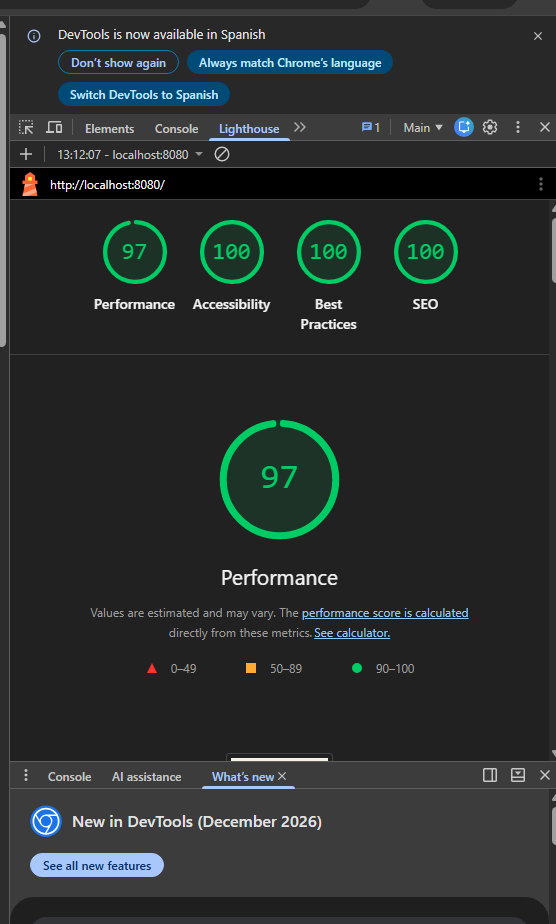

# Auditoría Lighthouse - Correcciones de Performance y SEO

## Información general

- Fecha: 27/11/2026.
- Responsable: Juan Martin Britos (@juanmartinbritos7-cmd).
- Rol: Coordinador / DevOps.
- Rama: fix/lighthouse-performance-seo.
- Commit base: 3d41731.
- Issues relacionadas: #139 y #140.
- Navegador: Google Chrome.
- URL: http://localhost:8080/.
- Servidor local: http-server mediante Node.js.

## Objetivo

Resolver los problemas de Performance y SEO
identificados por el Tester QA durante las auditorías
Lighthouse del Segundo Parcial.

## Correcciones implementadas

### Issue #139 - Performance

- Eliminación de @import de Google Fonts en css/styles.css.
- Carga de las fuentes mediante link en index.html.
- Incorporación de preconnect para fonts.googleapis.com.
- Incorporación de preconnect para fonts.gstatic.com.
- Conservación de font-display swap mediante display=swap.
- Incorporación del atributo defer al script de Bootstrap.

### Issue #140 - SEO

- Incorporación de meta description en index.html.

### Corrección adicional - Best Practices

- Declaración de un favicon vacío mediante data URI
  para evitar la solicitud automática de favicon.ico
  que anteriormente generaba un error 404.

## Comparación de resultados Lighthouse

| Categoría | Baseline TC11 | Post-fetch TC12 | Post-correcciones | Umbral |
|---|---:|---:|---:|---:|
| Performance | 93 | 96 | 97 | 95 |
| Accessibility | 100 | 100 | 100 | 95 |
| Best Practices | 96 | 96 | 100 | 95 |
| SEO | 91 | 91 | 100 | 95 |

Las cuatro categorías alcanzaron el umbral mínimo
establecido para el Segundo Parcial en esta ejecución.

## Evidencia de Lighthouse



## Validación automatizada

Comandos ejecutados:

```powershell
npm.cmd test
npm.cmd run cobertura
```

| Comando | Resultado | Seed | Tiempo |
|---|---|---|---|
| npm.cmd test | 167 specs, 0 failures | 47394 | 1,054 s |
| npm.cmd run cobertura | 167 specs, 0 failures | 02157 | 1,67 s |

## Comparación de cobertura

| Indicador | Antes | Después |
|---|---:|---:|
| Sentencias | 95,41% | 95,41% |
| Ramas | 94,16% | 94,16% |
| Funciones | 97,91% | 97,91% |
| Líneas | 95,41% | 95,41% |

No se detectaron regresiones en las pruebas automatizadas
ni disminuciones en la cobertura.

## Limitaciones

La auditoría se realizó utilizando Google Chrome y
http-server, mientras que las auditorías anteriores
del Tester QA utilizaron Microsoft Edge y un servidor
local de Python.

Por lo tanto, las diferencias de rendimiento no pueden
atribuirse exclusivamente a las modificaciones realizadas.

Esta auditoría complementaria no reemplaza el
Test Case 13 de Lighthouse post-library.

## Validación funcional en navegador

- [x] Carga del catálogo mediante Fetch.
- [x] Visualización de imágenes y fuentes.
- [x] Funcionamiento de las animaciones de AOS.
- [x] Apertura y cierre del modal de Bootstrap.
- [x] Incorporación de productos al carrito.
- [x] Modificación de cantidades y eliminación de productos.
- [x] Ausencia de errores en la consola.

Resultado: validación funcional satisfactoria.

## Conclusión

Las correcciones implementadas permitieron obtener
resultados satisfactorios en las cuatro categorías
de Lighthouse, manteniendo las 167 pruebas automatizadas
sin fallos y la cobertura existente.

La resolución definitiva de las issues #139 y #140
queda sujeta a la revisión del PR, su integración
y la validación final del Tester QA.