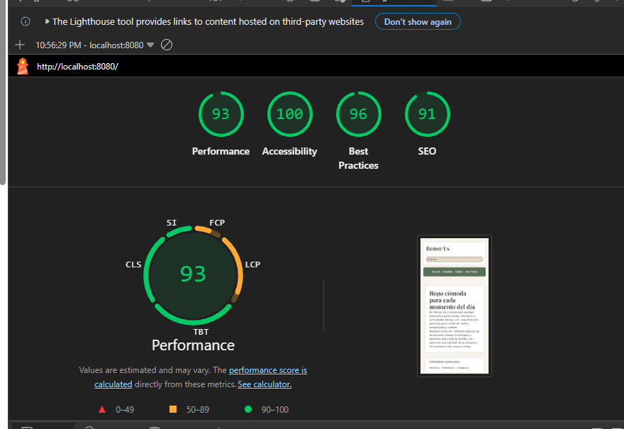
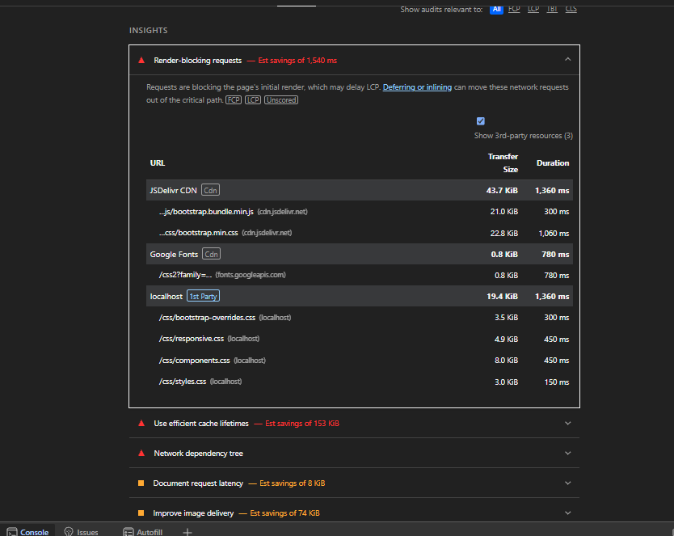
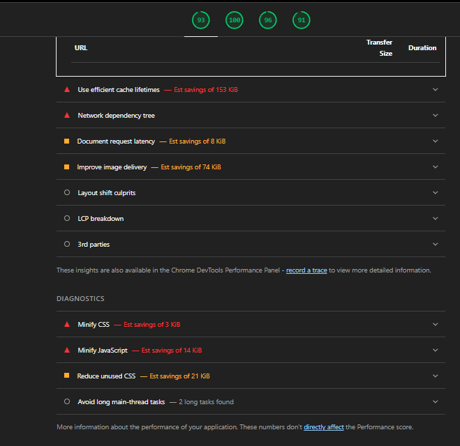
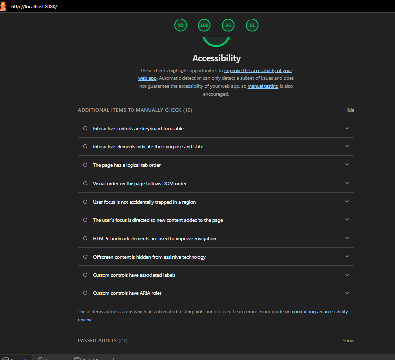
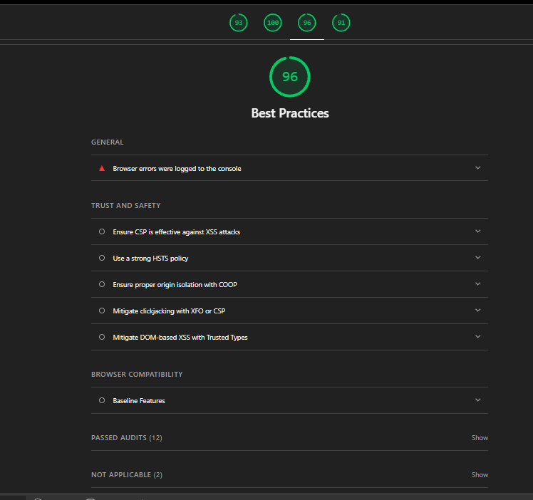
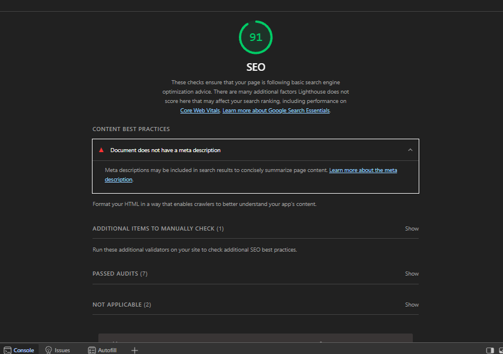

# Test Case 11: Auditoría Lighthouse - Baseline Inicial

## Información General

- **Fecha de ejecución:** 26/11/2026
- **URL testeada:** `http://localhost:8080/` (contenido de `develop` servido localmente con `python -m http.server 8080`; GitHub Pages publica una rama de release y no `develop`)
- **Rama:** `develop` (antes de integrar las feature branches del parcial)
- **Navegador:** Microsoft Edge 158.0.4370.33 (Chromium 158.0.8127.37), ventana InPrivate, sin extensiones
- **Configuración de Lighthouse:** modo Navigation, dispositivo Mobile, categorías Performance, Accessibility, Best Practices y SEO
- **Responsable:** Sebastian Viel (@Zikoloogo) – Tester QA/JS
- **Herramienta:** Lighthouse (DevTools de Microsoft Edge)

## Umbrales Mínimos Definidos

- **Performance:** ≥ 95
- **Accessibility:** ≥ 95
- **Best Practices:** ≥ 95
- **SEO:** ≥ 95

## Resumen de Resultados

| Categoría | Puntaje | Umbral | Estado |
|---|---|---|---|
| Performance | 93 | ≥ 95 | No cumple |
| Accessibility | 100 | ≥ 95 | Cumple |
| Best Practices | 96 | ≥ 95 | Cumple |
| SEO | 91 | ≥ 95 | No cumple |

## Resultados Obtenidos

### Performance: 93

- First Contentful Paint: 2,5 s
- Largest Contentful Paint: 2,6 s
- Total Blocking Time: 0 ms
- Cumulative Layout Shift: 0,026
- Speed Index: 2,5 s

Oportunidades (Insights) detectadas:

- **Render-blocking requests:** ahorro estimado de 1.540 ms.
  - `bootstrap.min.css` (jsDelivr): 22,8 KiB, 1.060 ms
  - Google Fonts (`css2?family=...`): 0,8 KiB, 780 ms
  - `bootstrap.bundle.min.js` (jsDelivr): 21,0 KiB, 300 ms
  - `css/components.css`: 8,0 KiB, 450 ms
  - `css/responsive.css`: 4,9 KiB, 450 ms
  - `css/bootstrap-overrides.css`: 3,5 KiB, 300 ms
  - `css/styles.css`: 3,0 KiB, 150 ms
- **Use efficient cache lifetimes:** ahorro estimado de 153 KiB.
- **Improve image delivery:** ahorro estimado de 74 KiB.
- **Document request latency:** ahorro estimado de 8 KiB.
- Network dependency tree, layout shift culprits, LCP breakdown y 3rd parties (informativos).

Diagnósticos:

- Minify CSS: ahorro estimado de 3 KiB.
- Minify JavaScript: ahorro estimado de 14 KiB.
- Reduce unused CSS: ahorro estimado de 21 KiB.
- Avoid long main-thread tasks: 2 tareas largas.

> Nota: la medición se hizo con un servidor local simple, que no envía encabezados de caché. El hallazgo de "efficient cache lifetimes" puede variar en GitHub Pages.

### Accessibility: 100

- No se detectaron auditorías fallidas (27 aprobadas).
- Quedan 10 ítems de revisión manual (foco por teclado, orden de tabulación, landmarks HTML5, roles ARIA, etc.), que Lighthouse no puede validar automáticamente.

### Best Practices: 96

- Falla: **se registraron errores del navegador en la consola** (causa: el servidor local `python -m http.server` responde `404` a `/favicon.ico`, porque el proyecto no tiene favicon; Chromium lo pide automáticamente y el error queda en consola).
- 12 auditorías aprobadas y 2 no aplicables.
- Ítems informativos de seguridad sin puntaje (CSP, HSTS, aislamiento COOP, protección contra clickjacking, Trusted Types): dependen de encabezados HTTP del servidor y no aplican a un sitio estático en GitHub Pages.
- Observación: la consola de Edge muestra avisos de "Tracking Prevention" sobre recursos de `cdn.jsdelivr.net`. Son avisos del navegador y no un defecto del proyecto.

### SEO: 91

- Falla: **el documento no tiene meta description.**
- 7 auditorías aprobadas, 2 no aplicables y 1 ítem de revisión manual.

## Issues Generadas

- [#139] Performance 93 (<95): reducir recursos que bloquean el renderizado (asignada a Coordinador/DevOps)
- [#140] SEO 91 (<95): falta meta description en `index.html` (asignada a Coordinador/DevOps)
- Best Practices: no se genera issue, porque el puntaje (96) cumple el umbral de 95. El único hallazgo (falta de `favicon.ico`, 404) es menor; se deja como observación y se puede resolver junto con la issue #140 agregando `<link rel="icon" href="data:,">` o un favicon real.

## Resultado final

**TC11: baseline registrado.** Accessibility (100) y Best Practices (96) cumplen el umbral de 95. Performance (93) y SEO (91) no lo cumplen y se reportaron en las issues #139 y #140.

## Conclusiones

El proyecto parte con un baseline sólido: Accessibility alcanza 100 y Best Practices 96, ambos por encima del umbral de 95. Performance (93) y SEO (91) quedan por debajo y se reportan como issues.

En Performance, la principal oportunidad es el bloqueo del renderizado (1.540 ms estimados), causado por las hojas de estilo de Bootstrap, Google Fonts y los cuatro CSS propios, a lo que se suman el peso de las imágenes (74 KiB) y el CSS sin usar (21 KiB). El problema de SEO tiene una solución directa: agregar una meta description en `index.html`.

La primera corrida de prueba se había hecho en una ventana normal y dio Performance 90, con diagnósticos de JavaScript inflados por extensiones del navegador. Por eso el baseline válido es el de la ventana InPrivate.

Este baseline es la referencia contra la cual se compararán los Test Cases 12 (post-fetch) y 13 (post-librería) para comprobar que las nuevas funcionalidades no degraden el rendimiento.