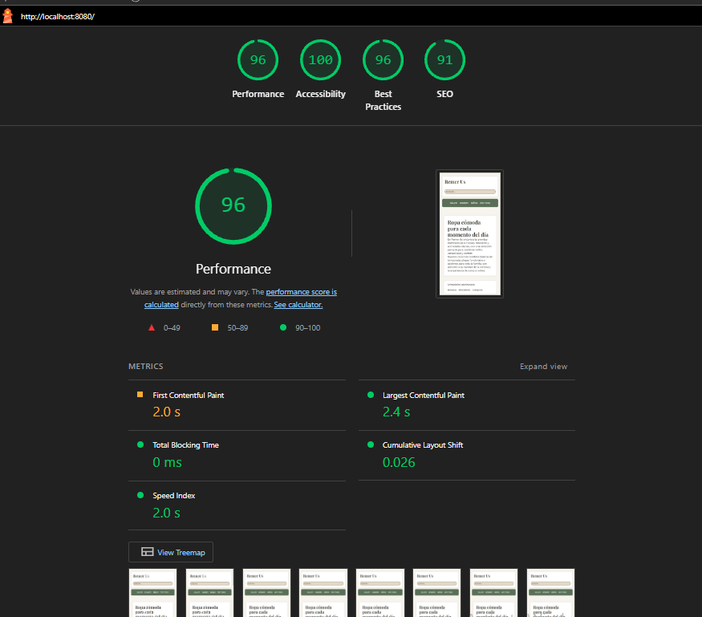
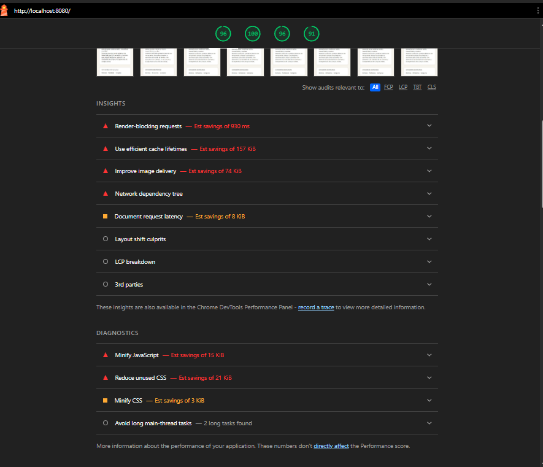
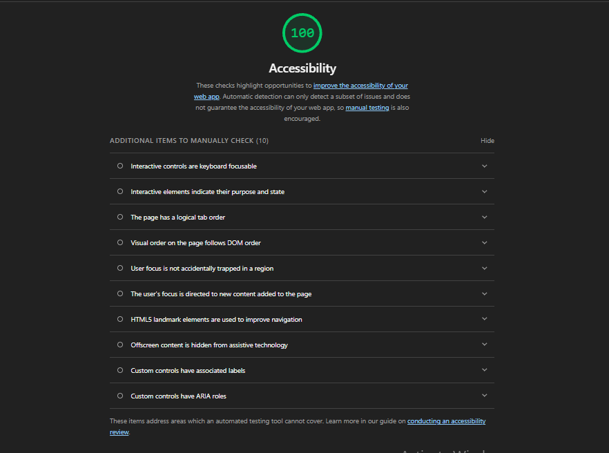
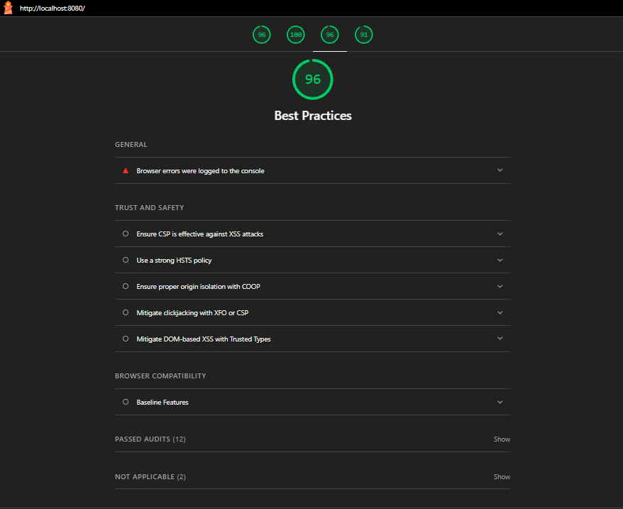
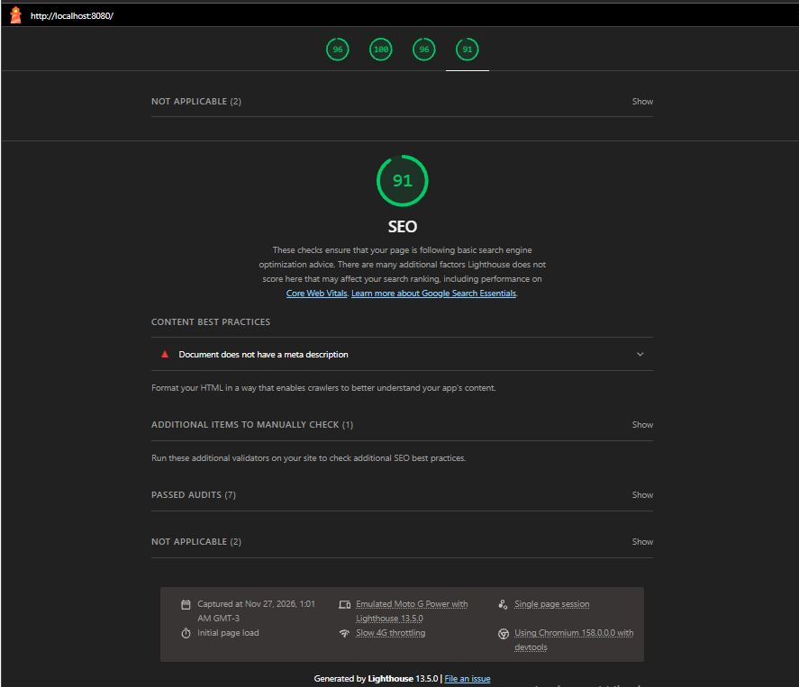

# Test Case 12: Auditoría Lighthouse - Post Fetch

## Información General

- **Fecha de ejecución:** 27/11/2026
- **URL testeada:** `http://localhost:8080/` (servida localmente con `python -m http.server 8080`)
- **Rama:** `feature/tester-qa-js-testing-suite`, que incluye `develop` con el PR #137 (carga asíncrona del catálogo con Fetch) y todavía no incluye la librería externa (PR #136)
- **Navegador:** Microsoft Edge (Chromium 158), ventana InPrivate, sin extensiones
- **Configuración de Lighthouse:** versión 13.5.0, modo Navigation, dispositivo Mobile (Moto G Power emulado, Slow 4G), categorías Performance, Accessibility, Best Practices y SEO
- **Responsable:** Sebastian Viel (@Zikoloogo) – Tester QA/JS
- **Herramienta:** Lighthouse (DevTools de Microsoft Edge)
- **Referencia:** [Test Case 11 (baseline)](./test-case-11-lighthouse-baseline.md)

## Umbrales Mínimos Definidos

- **Performance:** ≥ 95
- **Accessibility:** ≥ 95
- **Best Practices:** ≥ 95
- **SEO:** ≥ 95

## Resumen de Resultados

| Categoría | Baseline (TC11) | Post-fetch (TC12) | Variación | Umbral | Estado |
|---|---|---|---|---|---|
| Performance | 93 | 96 | +3 | ≥ 95 | Cumple |
| Accessibility | 100 | 100 | 0 | ≥ 95 | Cumple |
| Best Practices | 96 | 96 | 0 | ≥ 95 | Cumple |
| SEO | 91 | 91 | 0 | ≥ 95 | No cumple |

## Resultados Obtenidos

### Performance: 96

| Métrica | Baseline | Post-fetch |
|---|---|---|
| First Contentful Paint | 2,5 s | 2,0 s |
| Largest Contentful Paint | 2,6 s | 2,4 s |
| Total Blocking Time | 0 ms | 0 ms |
| Cumulative Layout Shift | 0,026 | 0,026 |
| Speed Index | 2,5 s | 2,0 s |

Oportunidades (Insights) detectadas:

- **Render-blocking requests:** ahorro estimado de 930 ms (baseline: 1.540 ms).
- **Use efficient cache lifetimes:** ahorro estimado de 157 KiB (baseline: 153 KiB).
- **Improve image delivery:** ahorro estimado de 74 KiB (sin cambios).
- **Document request latency:** ahorro estimado de 8 KiB (sin cambios).
- Network dependency tree, layout shift culprits, LCP breakdown y 3rd parties (informativos).

Diagnósticos:

- Minify JavaScript: ahorro estimado de 15 KiB (baseline: 14 KiB).
- Reduce unused CSS: ahorro estimado de 21 KiB (sin cambios).
- Minify CSS: ahorro estimado de 3 KiB (sin cambios).
- Avoid long main-thread tasks: 2 tareas largas (sin cambios).

> Nota: Lighthouse tiene variabilidad entre ejecuciones y la medición se hizo con un servidor local sin encabezados de caché. La mejora de Performance (93 → 96) se registra como resultado medido y no se atribuye únicamente al cambio a Fetch. El único efecto directo observable en el código es el leve aumento de JavaScript sin minificar (14 → 15 KiB) por el nuevo módulo `js/api/apiService.js`.

### Accessibility: 100

- No se detectaron auditorías fallidas.
- Quedan 10 ítems de revisión manual (igual que en el baseline).

### Best Practices: 96

- Falla: **se registraron errores del navegador en la consola.** Es el mismo hallazgo del baseline: el servidor local responde `404` a `/favicon.ico` porque el proyecto no tiene favicon.
- 12 auditorías aprobadas y 2 no aplicables (igual que en el baseline).
- Ítems informativos de seguridad sin puntaje (CSP, HSTS, COOP, clickjacking, Trusted Types): dependen de encabezados HTTP del servidor.

### SEO: 91

- Falla: **el documento no tiene meta description** (igual que en el baseline).
- 7 auditorías aprobadas, 2 no aplicables y 1 ítem de revisión manual.

## Comparación con el Baseline

- **Performance** mejora de 93 a 96 y pasa a cumplir el umbral. Mejoran FCP (2,5 → 2,0 s), LCP (2,6 → 2,4 s) y Speed Index (2,5 → 2,0 s); TBT y CLS no cambian.
- **Accessibility** y **Best Practices** se mantienen sin cambios.
- **SEO** se mantiene en 91 por la falta de meta description.
- La carga asíncrona del catálogo no introdujo regresiones en ninguna categoría.

## Issues Generadas

- No se generan issues nuevas: no hay regresiones respecto del baseline.
- Siguen abiertas las issues del TC11: [#139] (Performance: recursos que bloquean el renderizado; el puntaje ya cumple el umbral, pero el hallazgo sigue vigente) y [#140] (SEO: falta meta description).

## Resultado final

**TC12: sin regresiones.** Performance (96), Accessibility (100) y Best Practices (96) cumplen el umbral de 95. SEO (91) no lo cumple y sigue reportado en la issue #140.