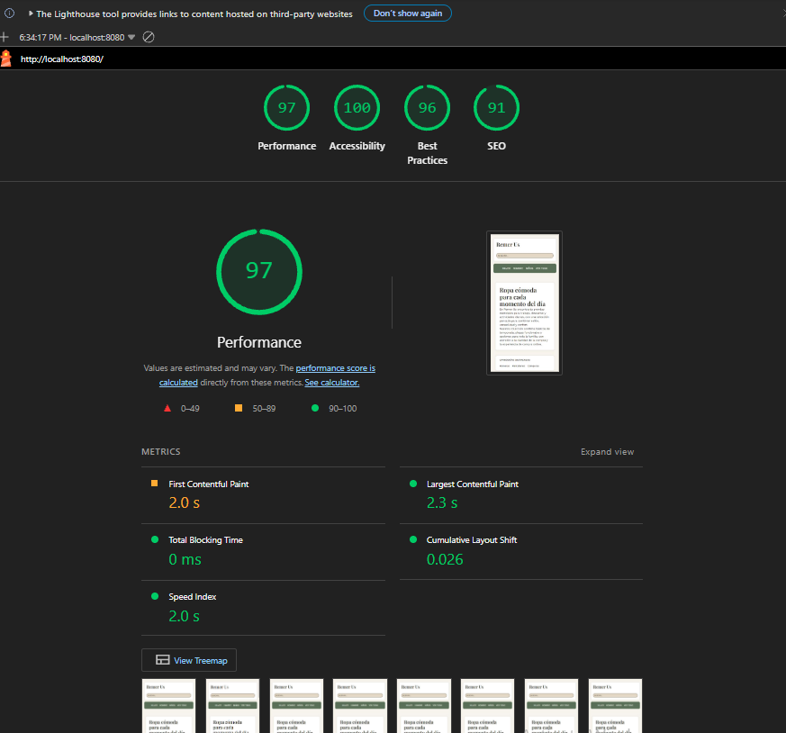
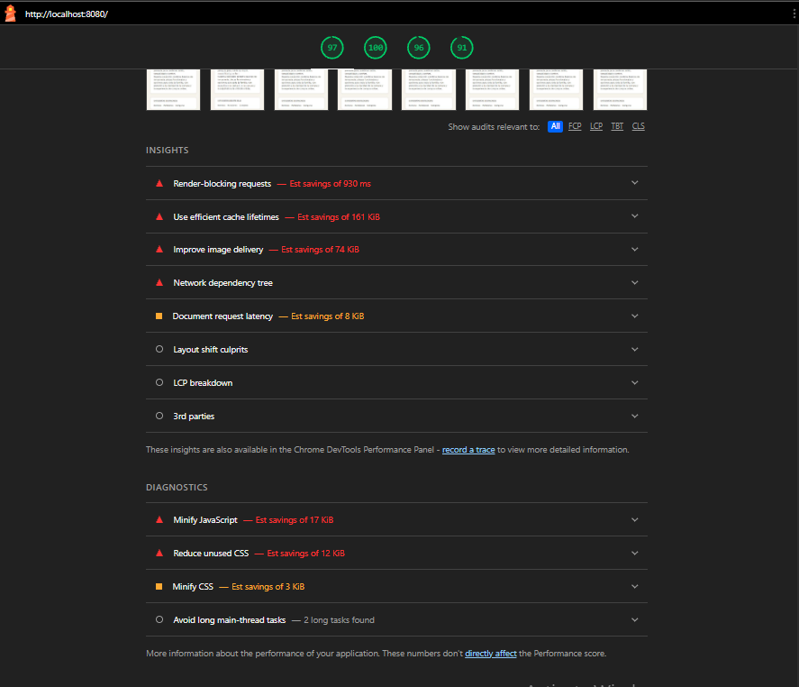
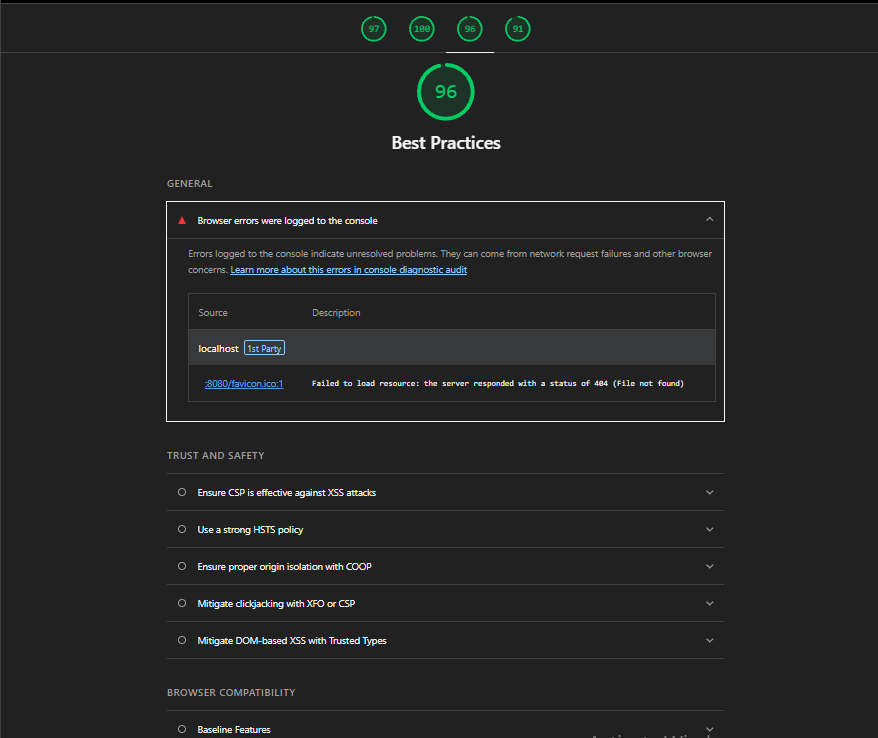
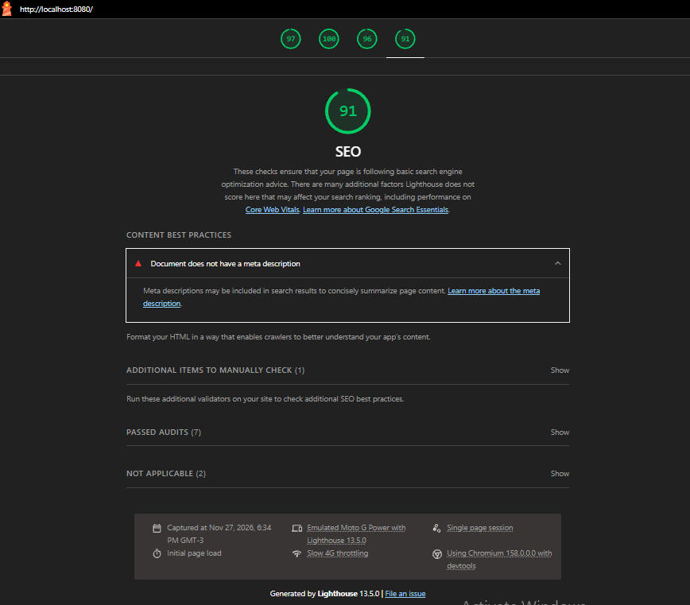

# Test Case 13: Auditoría Lighthouse - Post Librería Externa

## Información General

- **Fecha de ejecución:** 27/11/2026
- **URL testeada:** `http://localhost:8080/` (servida localmente con `python -m http.server 8080`)
- **Rama:** `feature/tester-qa-js-testing-suite`, con `develop` incorporado: incluye el PR #137 (Fetch) y el PR #136 (librería AOS, commit de integración `3d41731`)
- **Navegador:** Microsoft Edge (Chromium 158), ventana InPrivate, sin extensiones
- **Configuración de Lighthouse:** versión 13.5.0, modo Navigation, dispositivo Mobile (Moto G Power emulado, Slow 4G), categorías Performance, Accessibility, Best Practices y SEO
- **Responsable:** Sebastian Viel (@Zikoloogo) – Tester QA/JS
- **Herramienta:** Lighthouse (DevTools de Microsoft Edge)
- **Referencias:** [TC11 (baseline)](./test-case-11-lighthouse-baseline.md) y [TC12 (post-fetch)](./test-case-12-lighthouse-post-fetch.md)

## Umbrales Mínimos Definidos

- **Performance:** ≥ 95
- **Accessibility:** ≥ 95
- **Best Practices:** ≥ 95
- **SEO:** ≥ 95

## Resumen de Resultados

| Categoría | TC11 Baseline | TC12 Post-fetch | TC13 Post-librería | Umbral | Estado |
|---|---|---|---|---|---|
| Performance | 93 | 96 | 97 | ≥ 95 | Cumple |
| Accessibility | 100 | 100 | 100 | ≥ 95 | Cumple |
| Best Practices | 96 | 96 | 96 | ≥ 95 | Cumple |
| SEO | 91 | 91 | 91 | ≥ 95 | No cumple |

## Resultados Obtenidos

### Performance: 97

| Métrica | TC11 | TC12 | TC13 |
|---|---|---|---|
| First Contentful Paint | 2,5 s | 2,0 s | 2,0 s |
| Largest Contentful Paint | 2,6 s | 2,4 s | 2,3 s |
| Total Blocking Time | 0 ms | 0 ms | 0 ms |
| Cumulative Layout Shift | 0,026 | 0,026 | 0,026 |
| Speed Index | 2,5 s | 2,0 s | 2,0 s |

Oportunidades (Insights) detectadas:

- **Render-blocking requests:** ahorro estimado de 930 ms (TC12: 930 ms).
- **Use efficient cache lifetimes:** ahorro estimado de 161 KiB (TC12: 157 KiB).
- **Improve image delivery:** ahorro estimado de 74 KiB (sin cambios).
- **Document request latency:** ahorro estimado de 8 KiB (sin cambios).
- Network dependency tree, layout shift culprits, LCP breakdown y 3rd parties (informativos).

Diagnósticos:

- Minify JavaScript: ahorro estimado de 17 KiB (TC12: 15 KiB). El aumento de 2 KiB corresponde al nuevo módulo `js/utils/animaciones.js`.
- Reduce unused CSS: ahorro estimado de 12 KiB (TC12: 21 KiB).
- Minify CSS: ahorro estimado de 3 KiB (sin cambios).
- Avoid long main-thread tasks: 2 tareas largas (sin cambios).

> Nota: Lighthouse tiene variabilidad entre ejecuciones y la medición se hizo con un servidor local sin encabezados de caché. Las diferencias de 1 punto o décimas de segundo entre mediciones no se atribuyen a un cambio concreto del código. La librería AOS (cargada por CDN) no produjo una regresión de Performance medible.

### Accessibility: 100

- El puntaje se mantiene en 100, igual que en el baseline y en el post-fetch.
- Las animaciones de AOS no introducen fallos de accesibilidad detectables automáticamente. El wrapper respeta `prefers-reduced-motion`, verificado en `library.spec.js`.

### Best Practices: 96

- Falla: **se registraron errores del navegador en la consola.** Detalle visible en el reporte: `:8080/favicon.ico:1 - Failed to load resource: the server responded with a status of 404 (File not found)`. Es el mismo hallazgo del baseline y del post-fetch: el proyecto no tiene favicon.
- La librería AOS no agregó errores de consola.

### SEO: 91

- Falla: **el documento no tiene meta description** (igual que en el baseline y en el post-fetch).
- 7 auditorías aprobadas, 2 no aplicables y 1 ítem de revisión manual.

## Comparación entre los Tres Momentos

- **Performance:** 93 → 96 → 97. Mejora sostenida; FCP y Speed Index se mantienen en 2,0 s desde el post-fetch y LCP baja de 2,6 s a 2,3 s.
- **Accessibility:** 100 en los tres momentos.
- **Best Practices:** 96 en los tres momentos, con la misma causa (`favicon.ico` 404 del servidor local).
- **SEO:** 91 en los tres momentos, por la falta de meta description.
- Ni la carga asíncrona con Fetch ni la integración de AOS introdujeron regresiones.

## Issues Generadas

- No se generan issues nuevas: no hay regresiones respecto de los momentos anteriores.
- Siguen abiertas las issues del TC11: [#139] (Performance: recursos que bloquean el renderizado) y [#140] (SEO: falta meta description). Según informó el Coordinador, sus correcciones están en su rama y todavía no se integraron a `develop`, por lo que no se reflejan en esta medición.

## Resultado final

**TC13: sin regresiones.** Performance (97), Accessibility (100) y Best Practices (96) cumplen el umbral de 95. SEO (91) no lo cumple y sigue reportado en la issue #140.