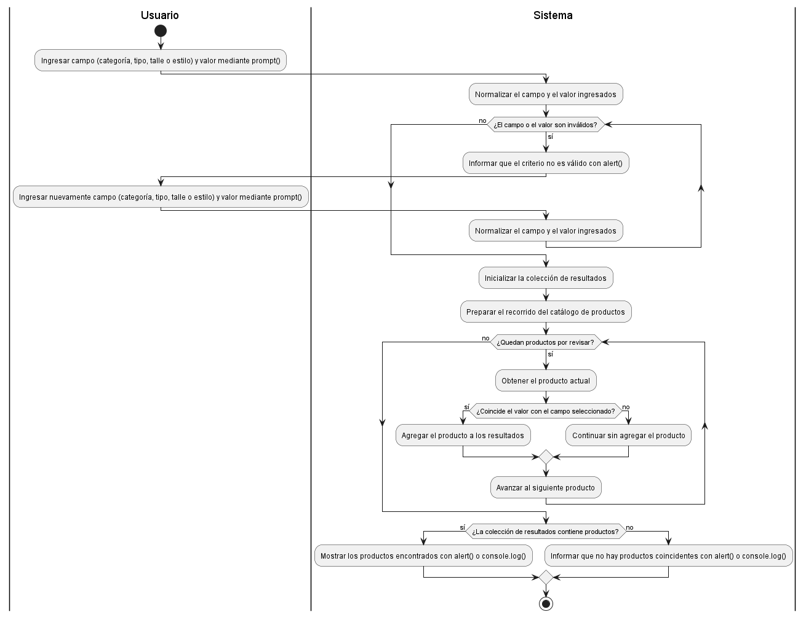
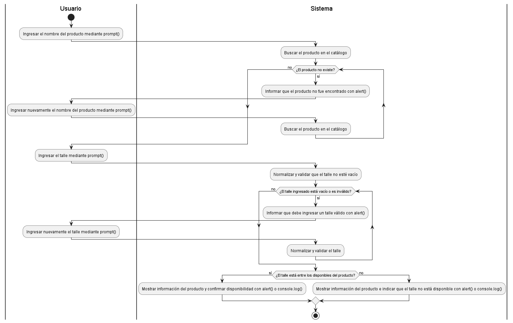
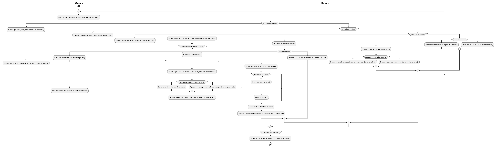
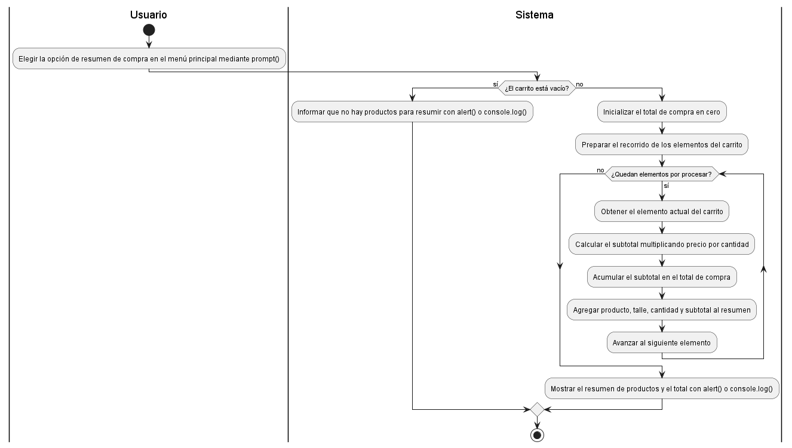

# Diagramas de actividades — Remer Us (Actividad Obligatoria N°3)

Esta carpeta contiene los 4 diagramas de actividades de los flujos principales de la tienda, modelados con PlantUML. Los flujos están definidos en la sección 10.3 del [plan.md](../../../plan.md) y los diagramas son el contrato de implementación para `js/script.js` y los tests de Jasmine.

Todos los diagramas usan swimlanes `|Usuario|` y `|Sistema|`, porque cada flujo combina entradas del usuario mediante `prompt()` con procesamiento y salidas del sistema mediante `alert()` / `console.log()`.

## Índice

1. [Flujo 1 — Consultar y filtrar el catálogo](#flujo-1--consultar-y-filtrar-el-catálogo)
2. [Flujo 2 — Consultar producto y disponibilidad de talle](#flujo-2--consultar-producto-y-disponibilidad-de-talle)
3. [Flujo 3 — Gestionar carrito simulado](#flujo-3--gestionar-carrito-simulado)
4. [Flujo 4 — Generar resumen de compra](#flujo-4--generar-resumen-de-compra)
5. [Cómo editar los diagramas](#cómo-editar-los-diagramas)

---

## Flujo 1 — Consultar y filtrar el catálogo

**Descripción:** el usuario ingresa un campo de filtrado (categoría, tipo de prenda, talle o estilo) y un valor. El sistema valida el criterio, recorre el catálogo de productos y muestra los que coinciden o informa que no hay resultados.

- **Entrada:** campo y valor de filtrado.
- **Proceso:** validación del criterio y recorrido del array de productos.
- **Salida:** productos que coinciden con el criterio.
- **Archivo editable:** [actividad-flujo-1-consultar-filtrar-catalogo.puml](actividad-flujo-1-consultar-filtrar-catalogo.puml)

---

## Flujo 2 — Consultar producto y disponibilidad de talle

**Descripción:** el usuario indica un producto y un talle. El sistema busca el producto en el catálogo, valida el talle y confirma si está entre los disponibles.

- **Entrada:** nombre del producto y talle.
- **Proceso:** búsqueda del producto y validación de disponibilidad del talle.
- **Salida:** información del producto y resultado de disponibilidad.
- **Archivo editable:** [actividad-flujo-2-consultar-producto-talle.puml](actividad-flujo-2-consultar-producto-talle.puml)

---

## Flujo 3 — Gestionar carrito simulado

**Descripción:** el usuario elige una acción (agregar, modificar, eliminar o salir) en un menú que se repite hasta que decide salir. El sistema valida los datos, actualiza el array que representa el carrito y muestra su estado. Si el producto y talle ya están en el carrito, se suma la cantidad en lugar de duplicar el elemento.

- **Entrada:** acción elegida y datos del producto, talle y cantidad.
- **Proceso:** validación y actualización del array del carrito.
- **Salida:** estado actualizado del carrito.
- **Archivo editable:** [actividad-flujo-3-gestionar-carrito.puml](actividad-flujo-3-gestionar-carrito.puml)

> Por la cantidad de decisiones anidadas, este es el diagrama más ancho. Para verlo con más detalle, abrir el `.png` a tamaño completo o previsualizar el `.puml`.

---

## Flujo 4 — Generar resumen de compra

**Descripción:** el sistema revisa si el carrito tiene productos. Si está vacío, lo informa. Si no, recorre los elementos, calcula el subtotal de cada uno (precio por cantidad), acumula el total y muestra el resumen.

- **Entrada:** contenido actual del carrito.
- **Proceso:** recorrido de los elementos y cálculo de subtotales y total.
- **Salida:** resumen de compra y total calculado.
- **Archivo editable:** [actividad-flujo-4-resumen-compra.puml](actividad-flujo-4-resumen-compra.puml)

---

## Cómo editar los diagramas

**Opción A — Editor online**

1. Entrar a [plantumleditor.com](https://www.plantumleditor.com).
2. Pegar el contenido completo del `.puml` (desde `@startuml` hasta `@enduml`).
3. Modificar el código y verificar el resultado en la vista previa.
4. Descargar la imagen en PNG y reemplazar el archivo existente, conservando el mismo nombre.

**Opción B — Extensión de VS Code**

1. Instalar la extensión **PlantUML** (autor: jebbs).
2. Abrir el archivo `.puml` y presionar `Alt + D` para ver la vista previa.
3. Editar el código; la vista previa se actualiza.
4. Exportar con `Ctrl + Shift + P` → `PlantUML: Export Current Diagram` → formato `png`.

Al editar un diagrama, se debe actualizar también el `.png` para que ambos archivos queden sincronizados, y verificar que el flujo siga siendo coherente con `js/script.js`.