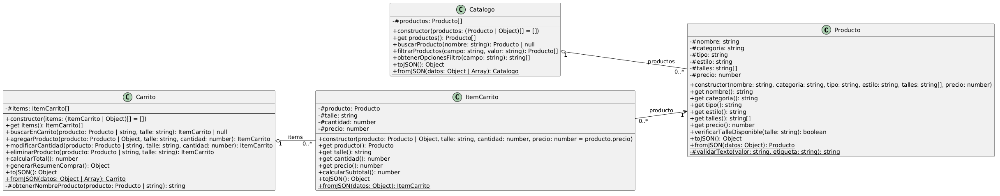

# Diagrama de Clases – Actividad Obligatoria N.º 4

## 1. Introducción

El presente documento describe el diagrama de clases desarrollado para el proyecto de tienda online, correspondiente a la Actividad Obligatoria N.º 4 de Programación Web I.

El objetivo es representar la arquitectura orientada a objetos implementada en JavaScript, identificando las clases del dominio, sus responsabilidades y las relaciones existentes entre ellas.

## 2. Clases implementadas

### 2.1 Producto

Representa un producto disponible en la tienda online.

Contiene información como nombre, categoría, tipo, estilo, talles disponibles y precio.

Su responsabilidad principal es mantener los datos del producto y verificar la disponibilidad de un talle solicitado.

### 2.2 Catalogo

Administra la colección de productos disponibles.

Permite buscar productos por nombre, aplicar filtros por categoría, tipo, talle o estilo y obtener las opciones disponibles para cada filtro.

### 2.3 ItemCarrito

Representa un producto seleccionado para una compra.

Contiene la referencia al producto, el talle elegido, la cantidad y el precio correspondiente.

Su responsabilidad principal es calcular el subtotal del elemento.

### 2.4 Carrito

Administra los elementos seleccionados por el usuario.

Permite agregar productos, modificar cantidades, eliminar elementos, calcular el total y generar el resumen de compra.

## 3. Relaciones entre clases

**Catalogo – Producto**

El catálogo agrupa productos disponibles para la venta. Se representa mediante una relación de agregación, ya que los productos pueden existir independientemente del catálogo.

**Carrito – ItemCarrito**

El carrito contiene los elementos seleccionados para la compra. Se representa mediante una relación de agregación, de acuerdo con la estructura implementada.

**ItemCarrito – Producto**

Cada elemento del carrito mantiene una referencia al producto correspondiente. Esta relación se representa mediante una asociación.

## 4. Principios de Programación Orientada a Objetos

La arquitectura implementada aplica los siguientes conceptos:

- **Abstracción:** cada clase representa una entidad del negocio con responsabilidades específicas.
- **Encapsulamiento:** las propiedades internas se protegen mediante atributos privados y se consultan a través de métodos públicos.
- **Modularidad:** las clases se encuentran separadas en archivos independientes dentro de `js/models/`.
- **Reutilización:** los métodos de negocio pueden utilizarse desde diferentes componentes de la aplicación.

No se utiliza herencia porque las entidades identificadas no requieren una jerarquía de clases.

## 5. Serialización de objetos

Las clases implementan métodos `toJSON()` y `fromJSON()` para convertir sus instancias a representaciones JSON y reconstruirlas posteriormente.

Esto facilita la integración con el módulo de almacenamiento desarrollado por el rol de JavaScript Storage.

## 6. Separación de responsabilidades

La lógica de negocio se encuentra encapsulada en las clases del dominio.

El archivo `js/script.js` será refactorizado por el desarrollador de Eventos + DOM para actuar como controlador de la aplicación.

Esta separación permite mantener independientes la lógica de negocio, la interfaz de usuario y la persistencia de datos.

## 7. Diagrama UML

El diagrama fue desarrollado mediante PlantUML y se encuentra disponible en los siguientes archivos:

- `diagrama-clases.puml`: código fuente editable del diagrama.
- `diagrama-clases.png`: representación gráfica exportada.

## 8. Conclusión

El diseño orientado a objetos permite organizar la lógica de la tienda online en clases con responsabilidades definidas.

La arquitectura propuesta facilita el mantenimiento del código, la reutilización de funcionalidades y la integración con los módulos de eventos, almacenamiento y testing.