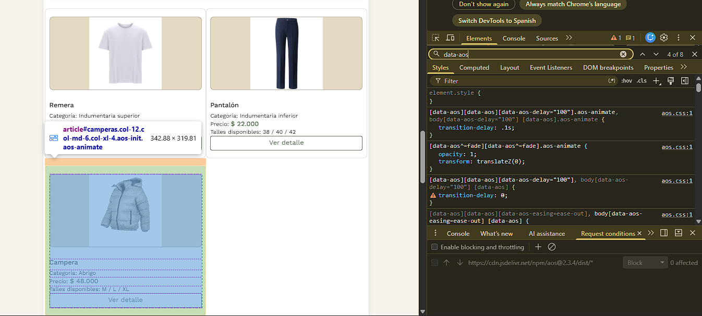
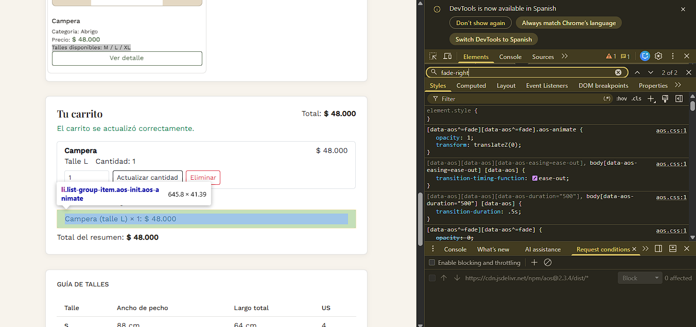
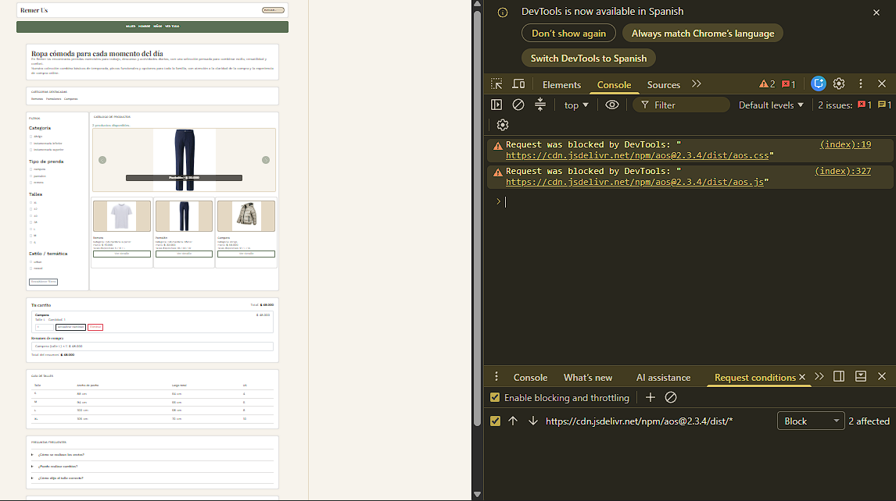

# Documentación de Librería Externa – AOS (Animate On Scroll)

## Información General

- **Nombre:** AOS – Animate On Scroll Library
- **Versión:** 2.3.4
- **Repositorio:** https://github.com/michalsnik/aos
- **Documentación oficial:** https://michalsnik.github.io/aos/
- **Rol y autor de la integración:** Desarrollador JS Librerías Externas – Lucas Ivan Fischer (@LucasFUces)
- **Issue:** #134

## Propósito y Justificación

La tienda renderiza dinámicamente las tarjetas de producto y las líneas del carrito y del resumen de compra. Cada vez que el usuario busca, filtra, agrega, modifica o elimina un producto, esos contenedores se vacían y se vuelven a llenar, y el contenido aparecía de golpe, sin ninguna señal visual del cambio.

AOS resuelve una animación de entrada para los elementos que aparecen en pantalla. No se resolvió con código propio porque exigiría implementar un `IntersectionObserver`, retrasos escalonados y los estados de visibilidad inicial y final. Además, la aplicación no tenía animaciones de entrada propias (no hay `@keyframes` ni `animation` en `css/`), por lo que la librería no duplica funcionalidad existente.

## Instalación e Integración

### Método utilizado: CDN (jsDelivr)

En `index.html`, el estilo dentro del `<head>`:

```html
<link rel="stylesheet" href="https://cdn.jsdelivr.net/npm/aos@2.3.4/dist/aos.css" />
```

Y el script, antes de `js/script.js`:

```html
<script src="https://cdn.jsdelivr.net/npm/aos@2.3.4/dist/aos.js"></script>
<script type="module" src="js/script.js"></script>
```

### Módulo wrapper: `js/utils/animaciones.js`

La librería queda encapsulada en un módulo. Es el único archivo que conoce el objeto global `AOS`; `script.js` solo invoca al wrapper.

| Método | Función |
|---|---|
| `estaDisponible()` | Indica si AOS cargó y expone `init` y `refreshHard`. |
| `prefiereMovimientoReducido()` | Detecta `prefers-reduced-motion: reduce`. |
| `iniciar()` | Inicializa AOS una sola vez con `{ duration: 500, easing: "ease-out", once: true, offset: 40, startEvent: "load" }`. |
| `animar(elemento, efecto, retraso)` | Agrega `data-aos` y `data-aos-delay` al elemento. |
| `refrescar()` | Llama a `AOS.refreshHard()` para detectar los elementos nuevos. Si falla, restaura la visibilidad del contenido. |
| `restaurarContenido()` | Quita `data-aos`, `data-aos-delay` y las clases de AOS de todos los elementos y desactiva el wrapper, para que el contenido siempre quede visible. |

Decisiones de diseño:

- **Degradación segura:** AOS deja invisible todo elemento con `data-aos` hasta animarlo. Si el CDN falla, o si el usuario pide movimiento reducido, el wrapper no agrega ningún atributo y el contenido se ve igual que antes.
- **Accesibilidad:** se respeta la preferencia del sistema `prefers-reduced-motion`.
- **Consistencia visual:** animaciones sutiles (500 ms, una sola vez por elemento) que no alteran colores, tamaños ni la maquetación de Bootstrap.

## Uso en el Proyecto

### Caso de Uso 1: Grilla de productos

En `renderizarCatalogo` de `js/script.js`, cada `<article>` recibe un efecto `fade-up` con retraso escalonado (máximo 300 ms). Aplica al cargar la página y al buscar o filtrar.

```js
for (const [indice, producto] of productos.entries()) {
  // ... se construye la tarjeta del producto ...
  Animaciones.animar(article, "fade-up", Math.min(indice * 50, 300));
  productGrid.append(article);
}
Animaciones.refrescar();
```



### Caso de Uso 2: Carrito y resumen de compra

En `renderizarCarrito`, cada línea del carrito y del resumen recibe un efecto `fade-right`.

```js
Animaciones.animar(listItem, "fade-right", Math.min(index * 50, 300));
// ...
Animaciones.animar(summaryItem, "fade-right", Math.min(index * 50, 300));
// ...
Animaciones.refrescar();
```



## Comportamiento sin la librería

Se verificó bloqueando la carga de `aos.css` y `aos.js` en las herramientas de desarrollo del navegador: la tienda se ve completa y funciona igual, sin animaciones.



## Enlaces

- Documentación oficial: https://michalsnik.github.io/aos/
- Repositorio: https://github.com/michalsnik/aos
- Paquete en jsDelivr: https://www.jsdelivr.com/package/npm/aos
