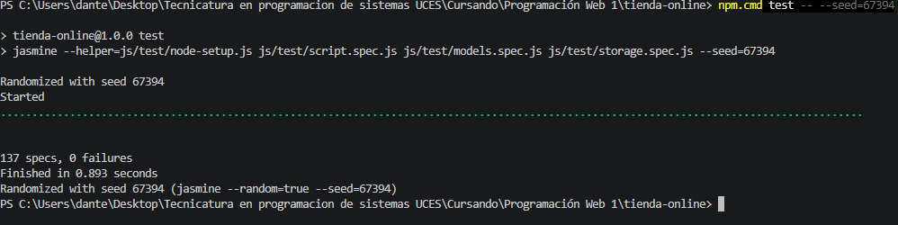

# Informe de testing — Actividad Obligatoria N.º 4

**Proyecto:** Remer Us — Tienda Online  
**Materia:** Programación Web I

## 1. Alcance de las pruebas

La suite de AO4 verifica el controlador de eventos y DOM, los modelos del dominio, las operaciones de Storage y el servicio de persistencia. En Node, las pruebas del controlador usan JSDOM para cargar el HTML de la aplicación y simular eventos del usuario.

| Suite | Alcance | Pruebas |
|---|---|---:|
| `js/test/script.spec.js` | Eventos y DOM del catálogo, modal, carrito y resumen de compra | 39 |
| `js/test/models.spec.js` | Clases `Producto`, `Catalogo`, `ItemCarrito` y `Carrito` | 63 |
| `js/test/storage.spec.js` | Operaciones de `StorageUtil`, manejo de errores y `PersistenciaService` | 48 |
| **Total en Node** | | **150** |

## 2. Ejecución en Node y cobertura

Desde la raíz del proyecto, en PowerShell:

```powershell
npm.cmd ci
npm.cmd test -- --seed=67394
npm.cmd run cobertura -- --seed=67394
```

Jasmine ejecutó **150 pruebas con 0 fallos**. `c8` genera el reporte en la terminal y en `coverage/index.html`. La semilla `67394` reproduce el orden de la ejecución registrada.

| Archivo o conjunto | Sentencias | Ramas | Funciones | Líneas |
|---|---:|---:|---:|---:|
| **Total medido** | **98,99 %** | **97,92 %** | **100 %** | **98,99 %** |
| `js/script.js` | 97,41 % | 92,85 % | 100 % | 97,41 % |
| `js/models/` | 100 % | 100 % | 100 % | 100 % |
| `js/services/PersistenciaService.js` | 100 % | 100 % | 100 % | 100 % |
| `js/utils/storage.js` | 100 % | 100 % | 100 % | 100 % |

Los **RC36 y RC37** verifican que un fallo de `console.error` no interrumpa el manejo de errores y que `guardar()` y `actualizar()` rechacen valores que se serializan como `undefined`. En `actualizar()` también se comprueba que el valor previo se conserve.

Los **RC38 al RC41** verifican que el controlador ignore envíos ajenos al formulario de cantidad, clics fuera del botón Eliminar y teclas distintas de Tab en el control del foco. También se prueba que un valor lanzado que no es una instancia de `Error` se vuelva a lanzar sin cambios.

Mediante la [PR #130](https://github.com/dantebiondi666-prog/tienda-online/pull/130) se incorporaron seis pruebas adicionales correspondientes a los RC45–RC49:

- **RC45:** apertura del modal con un producto inexistente, verificando la cancelación del evento, el mensaje de error y que el modal no se configure ni se abra.
- **RC46:** limpieza de la validación y del feedback de cantidad al restablecer el formulario del modal con una cantidad inválida.
- **RC47:** envío inválido del formulario del modal, verificando que el carrito y los datos persistidos no se modifiquen.
- **RC48:** evento `input` ajeno al control de cantidad del carrito, verificando que no se modifiquen el carrito, el feedback ni el estado del botón.
- **RC49:** tratamiento de errores de cuota de Storage con el nombre alternativo `NS_ERROR_DOM_QUOTA_REACHED` y de excepciones que no corresponden a errores de cuota.

Estas correcciones permitieron aumentar la cobertura global de líneas del 98,04 % al 98,99 % y la cobertura de ramas del 96,39 % al 97,92 %. Además, `js/utils/storage.js` alcanzó el 100 % de cobertura en todos los indicadores.

Las líneas que permanecen sin cubrir corresponden a `js/script.js`: 100–102, 116–126 y 243–244.



## 3. Ejecución en el navegador

Desde la raíz del proyecto, iniciar el servidor local:

```powershell
npx.cmd --yes http-server . -p 8080 -c-1
```

Abrir `http://127.0.0.1:8080/js/test/test-runner.html?seed=79108`. El runner HTML ejecuta `models.spec.js` y `storage.spec.js`. El resultado fue **111 pruebas con 0 fallos**.

El runner HTML (`test-runner.html`) incluye únicamente `models.spec.js` y `storage.spec.js`. Las demás suites se ejecutan **solo en Node**:

| Suite | Entorno | Motivo |
|---|---|---|
| `js/test/models.spec.js` | Node y navegador | No depende del DOM ni de APIs exclusivas de Node. |
| `js/test/storage.spec.js` | Node y navegador | Usa solo Storage, disponible en ambos entornos. |
| `js/test/script.spec.js` | Solo Node | Usa JSDOM para simular el navegador. |
| `js/test/api.spec.js` | Solo Node | Incluye un test de contrato que lee `api/productos.json` y verifica las imágenes con el sistema de archivos (`node:fs`); en el navegador ese test se marca como pendiente. |
| `js/test/library.spec.js` | Solo Node | Reemplaza `globalThis.document`, algo que los navegadores no permiten. |


## 4. Segundo Parcial: testing funcional y auditorías Lighthouse

### 4.1 Suites nuevas

| Suite | Alcance | Pruebas |
|---|---|---:|
| `js/test/api.spec.js` | Servicio `ApiService`: `fetchData`, `procesarProductos` y `crearMapaImagenes`, errores HTTP y de red, validación de datos y contrato con `api/productos.json` | 49 |
| `js/test/library.spec.js` | Wrapper `Animaciones` de la librería AOS: inicialización, `animar`, `refrescar`, `restaurarContenido`, movimiento reducido y CDN no disponible | 31 |
| `js/test/script.spec.js` (bloque "Integración de animaciones AOS") | Integración de AOS (`data-aos`, retrasos escalonados con tope de 300 ms, `AOS.init` una sola vez, `refreshHard` y render sin animaciones con movimiento reducido o sin la librería) y estados de carga, error de red, HTTP 500 y éxito del catálogo | 5 |

Las 17 pruebas originales de `api.spec.js` corresponden a la [PR #137](https://github.com/dantebiondi666-prog/tienda-online/pull/137); el rol Tester QA/JS agregó 32 casos (HTTP 400/403/503, extensiones e identificadores de imagen, precio NaN y decimal, nombres repetidos en el mapa de imágenes y contrato con el JSON real). Con las dos suites, `npm test` ejecuta **235 pruebas en Node**, a razón de 150 de AO4 más 49 de `api.spec.js`, 31 de `library.spec.js` y 5 nuevas en `script.spec.js` (1 de integración de AOS y 4 del estado de carga y de error del catálogo).

Con la librería integrada (`develop` con los PR #136 y #137 incorporado a la rama del tester), `npm test -- --seed=82574` ejecutó **235 pruebas con 0 fallos** y `npm run cobertura -- --seed=68382` midió:

| Archivo o conjunto | Sentencias | Ramas | Funciones | Líneas |
|---|---:|---:|---:|---:|
| **Total medido** | **98,91 %** | **97,36 %** | **100 %** | **98,91 %** |
| `js/script.js` | 97,04 % | 89,71 % | 100 % | 97,04 % |
| `js/api/apiService.js` | 100 % | 100 % | 100 % | 100 % |
| `js/utils/animaciones.js` | 100 % | 100 % | 100 % | 100 % |
| `js/models/`, `js/services/` y `js/utils/storage.js` | 100 % | 100 % | 100 % | 100 % |

Las líneas de `js/script.js` que siguen sin cubrir pueden consultarse en `coverage/index.html`. Los puntos de integración de AOS y el estado de carga y de error de `cargarCatalogo()` están cubiertos.

### 4.2 Auditorías Lighthouse

Lighthouse (Microsoft Edge, ventana InPrivate, modo Navigation, dispositivo Mobile), sobre la misma URL en cada momento:

| Test Case | Momento | Performance | Accessibility | Best Practices | SEO |
|---|---|---:|---:|---:|---:|
| [TC11](../../docs/04-testing/test-case-11-lighthouse-baseline.md) | Baseline | 93 | 100 | 96 | 91 |
| [TC12](../../docs/04-testing/test-case-12-lighthouse-post-fetch.md) | Post-fetch | 96 | 100 | 96 | 91 |
| [TC13](../../docs/04-testing/test-case-13-lighthouse-post-library.md) | Post-librería | 97 | 100 | 96 | 91 |

Los tres momentos se midieron sin regresiones. Umbral definido: ≥ 95 en las cuatro categorías; SEO (91) es la única categoría que no lo cumple. Issues derivadas: [#139](https://github.com/dantebiondi666-prog/tienda-online/issues/139) (Performance) y [#140](https://github.com/dantebiondi666-prog/tienda-online/issues/140) (SEO).

## 5. Informe histórico de AO3

El informe de la entrega anterior, incluido su retest, está disponible en el [tag `v1.1-tercera-entrega`](https://github.com/dantebiondi666-prog/tienda-online/blob/v1.1-tercera-entrega/js/test/testing-doc.md).