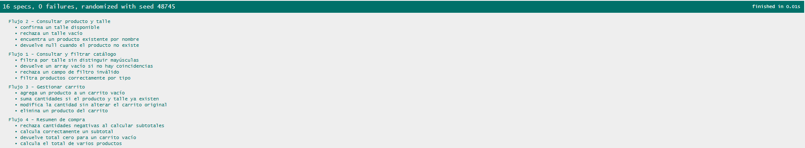
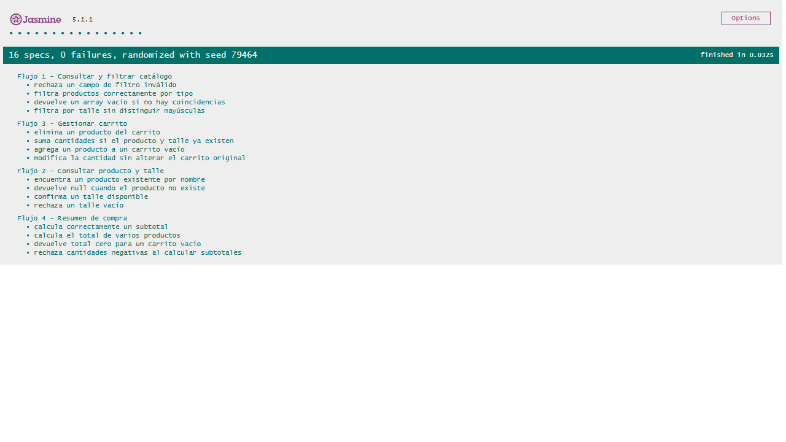

# Informe de Testing JavaScript — Jasmine

## 1. Información general

- **Proyecto:** Remer Us — Tienda Online
- **Materia:** Programación Web I
- **Entrega:** Actividad Obligatoria N.º 3
- **Responsable:** Juan Martin Britos
- **Rol:** Tester JavaScript / QA Engineer
- **Framework:** Jasmine 5.1.1
- **Herramienta de automatización:** Playwright MCP
- **Fecha de ejecución:** 30/10/2026
- **Issue asociada:** #88
- **Rama:** `feature/tester-javascript-jasmine`

## 2. Objetivo

Verificar mediante pruebas automatizadas el correcto funcionamiento de las operaciones JavaScript implementadas para el simulador de tienda online Remer Us.

Se evaluaron cuatro flujos funcionales: consulta y filtrado del catálogo, consulta de productos y talles, gestión del carrito y cálculo del resumen de compra.

## 3. Archivos involucrados

- `js/script.js`: código JavaScript bajo prueba.
- `js/test/test-runner.html`: ejecutor de Jasmine.
- `js/test/script.spec.js`: suites y casos de prueba.
- `js/test/capturas/`: evidencias visuales.
- `js/test/testing-doc.md`: presente informe.

## 4. Suites ejecutadas

| Suite | Funcionalidad | Tests | Resultado |
|---|---|---:|---|
| 1 | Consultar y filtrar catálogo | 4 | PASS |
| 2 | Consultar producto y talle | 4 | PASS |
| 3 | Gestionar carrito | 4 | PASS |
| 4 | Resumen de compra | 4 | PASS |
| **Total** | **4 flujos funcionales** | **16** | **PASS** |

## 5. Casos de prueba

### Suite 1 — Consultar y filtrar catálogo

1. Filtrar productos correctamente por tipo.
2. Filtrar por talle sin distinguir mayúsculas.
3. Devolver un array vacío cuando no existen coincidencias.
4. Rechazar un campo de filtro inválido.

**Resultado:** 4/4 PASS.

### Suite 2 — Consultar producto y talle

1. Encontrar un producto existente por nombre.
2. Devolver `null` cuando el producto no existe.
3. Confirmar la disponibilidad de un talle.
4. Rechazar una cadena vacía como talle.

**Resultado:** 4/4 PASS.

### Suite 3 — Gestionar carrito

1. Agregar un producto a un carrito vacío.
2. Acumular cantidades de un producto y talle existentes.
3. Modificar cantidades sin alterar el carrito original.
4. Eliminar un producto del carrito.

**Resultado:** 4/4 PASS.

### Suite 4 — Resumen de compra

1. Calcular correctamente el subtotal.
2. Devolver cero para un carrito vacío.
3. Calcular el total de varios productos.
4. Rechazar cantidades negativas.

**Resultado:** 4/4 PASS.

## 6. Ejecución manual con Jasmine

Se inició el servidor local y se accedió al ejecutor de Jasmine mediante:

`http://localhost:3000/js/test/test-runner.html`

El framework ejecutó las cuatro suites correctamente.

**Resultados obtenidos:**

- Tests ejecutados: 16.
- Tests aprobados: 16.
- Tests fallidos: 0.
- Resultado general: PASS.

**Evidencia:**

## 7. Ejecución automatizada con Playwright MCP

Se utilizó GitHub Copilot Agent Mode junto con Playwright MCP para abrir el ejecutor de Jasmine y verificar los resultados de las pruebas.

Playwright confirmó:

- Suites ejecutadas: 4.
- Tests ejecutados: 16.
- Tests aprobados: 16.
- Tests fallidos: 0.
- Resultado general: PASS.

**Evidencia:**

## 8. Incidencias y observaciones

Durante la ejecución con Playwright MCP se informó un error de carga de recurso en la consola del navegador.

No se identificó el recurso exacto en el reporte recibido, por lo que no se atribuye este mensaje al código JavaScript bajo prueba.

La incidencia queda pendiente de identificación si vuelve a reproducirse.

No se registraron fallos en los 16 casos de prueba ejecutados.

## 9. Alcance y limitaciones

Las pruebas verifican las funciones JavaScript seleccionadas mediante datos de prueba controlados.

El resultado PASS no implica que todas las posibles entradas, interacciones de interfaz o condiciones de ejecución estén cubiertas.

No se modificó `js/script.js` durante esta actividad de testing.

## 10. Conclusión

La ejecución manual con Jasmine y la ejecución automatizada mediante Playwright MCP finalizaron satisfactoriamente.

Los 16 casos de prueba correspondientes a los cuatro flujos funcionales obtuvieron resultado PASS.

Se dispone de evidencia visual de la ejecución manual y de la verificación automatizada, quedando documentados los resultados y las limitaciones de las pruebas.

**Resultado final: PASS — 16/16 tests aprobados.**
