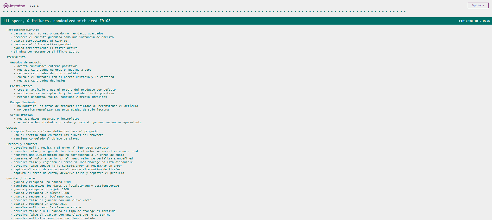

# Informe de testing — Actividad Obligatoria N.º 4

**Proyecto:** Remer Us — Tienda Online  
**Materia:** Programación Web I

## 1. Alcance de las pruebas

La suite de AO4 verifica el controlador de eventos y DOM, los modelos del dominio, las operaciones de Storage y el servicio de persistencia. En Node, las pruebas del controlador usan JSDOM para cargar el HTML de la aplicación y simular eventos del usuario.

| Suite | Alcance | Pruebas |
|---|---|---:|
| `js/test/script.spec.js` | Eventos y DOM del catálogo, modal, carrito y resumen de compra | 39 |
| `js/test/models.spec.js` | Clases `Producto`, `Catalogo`, `ItemCarrito` y `Carrito` | 63 |
| `js/test/storage.spec.js` | Operaciones de `StorageUtil`, manejo de errores y `PersistenciaService` | 48 |
| **Total en Node** | | **150** |

## 2. Ejecución en Node y cobertura

Desde la raíz del proyecto, en PowerShell:

```powershell
npm.cmd ci
npm.cmd test -- --seed=67394
npm.cmd run cobertura -- --seed=67394
```

Jasmine ejecutó **150 pruebas con 0 fallos**. `c8` genera el reporte en la terminal y en `coverage/index.html`. La semilla `67394` reproduce el orden de la ejecución registrada.

| Archivo o conjunto | Sentencias | Ramas | Funciones | Líneas |
|---|---:|---:|---:|---:|
| **Total medido** | **98,99 %** | **97,92 %** | **100 %** | **98,99 %** |
| `js/script.js` | 97,41 % | 92,85 % | 100 % | 97,41 % |
| `js/models/` | 100 % | 100 % | 100 % | 100 % |
| `js/services/PersistenciaService.js` | 100 % | 100 % | 100 % | 100 % |
| `js/utils/storage.js` | 100 % | 100 % | 100 % | 100 % |

Los **RC36 y RC37** verifican que un fallo de `console.error` no interrumpa el manejo de errores y que `guardar()` y `actualizar()` rechacen valores que se serializan como `undefined`. En `actualizar()` también se comprueba que el valor previo se conserve.

Los **RC38 al RC41** verifican que el controlador ignore envíos ajenos al formulario de cantidad, clics fuera del botón Eliminar y teclas distintas de Tab en el control del foco. También se prueba que un valor lanzado que no es una instancia de `Error` se vuelva a lanzar sin cambios.

Mediante la [PR #130](https://github.com/dantebiondi666-prog/tienda-online/pull/130) se incorporaron seis pruebas adicionales correspondientes a los RC45–RC49:

- **RC45:** apertura del modal con un producto inexistente, verificando la cancelación del evento, el mensaje de error y que el modal no se configure ni se abra.
- **RC46:** limpieza de la validación y del feedback de cantidad al restablecer el formulario del modal con una cantidad inválida.
- **RC47:** envío inválido del formulario del modal, verificando que el carrito y los datos persistidos no se modifiquen.
- **RC48:** evento `input` ajeno al control de cantidad del carrito, verificando que no se modifiquen el carrito, el feedback ni el estado del botón.
- **RC49:** tratamiento de errores de cuota de Storage con el nombre alternativo `NS_ERROR_DOM_QUOTA_REACHED` y de excepciones que no corresponden a errores de cuota.

Estas correcciones permitieron aumentar la cobertura global de líneas del 98,04 % al 98,99 % y la cobertura de ramas del 96,39 % al 97,92 %. Además, `js/utils/storage.js` alcanzó el 100 % de cobertura en todos los indicadores.

Las líneas que permanecen sin cubrir corresponden a `js/script.js`: 100–102, 116–126 y 243–244.


## 3. Ejecución en el navegador

Desde la raíz del proyecto, iniciar el servidor local:

```powershell
npx.cmd --yes http-server . -p 8080 -c-1
```

Abrir `http://127.0.0.1:8080/js/test/test-runner.html?seed=79108`. El runner HTML ejecuta `models.spec.js` y `storage.spec.js`. El resultado fue **111 pruebas con 0 fallos**.

Las pruebas de `script.spec.js` se ejecutan únicamente en Node, ya que utilizan JSDOM para simular el entorno del navegador.



## 4. Informe histórico de AO3

El informe de la entrega anterior, incluido su retest, está disponible en el [tag `v1.1-tercera-entrega`](https://github.com/dantebiondi666-prog/tienda-online/blob/v1.1-tercera-entrega/js/test/testing-doc.md).